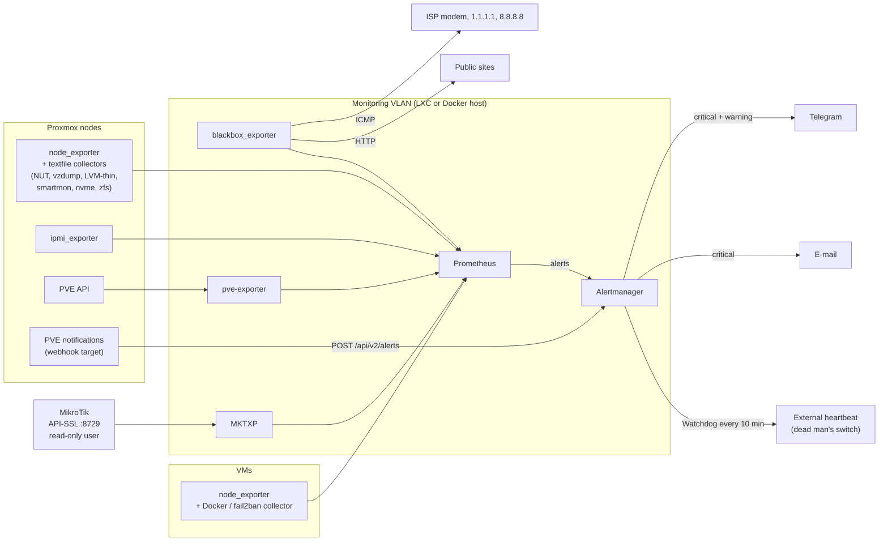

<div align="center">


# N3XUS Lab Observability

### Production-grade monitoring for a self-hosted Proxmox lab

Prometheus and Alertmanager rules, exporters and collectors for UPS, server hardware, backups, containers,
a MikroTik router and the internet uplink. Alerts go to Telegram and e-mail, with a dead man's switch.

[](https://n3xus.dev)
[](https://status.n3xus.dev)
[](LICENSE)

[](prometheus/prometheus.yml)
[](alertmanager/alertmanager.yml)
[](proxmox/notifications)
[](mktxp)
[](docker-compose.yml)
[](scripts/ci-local.sh)
[](SECURITY.md)

</div>

---

## Table of Contents

- [Overview](#overview)
- [Why this exists](#why-this-exists)
- [What it watches](#what-it-watches)
- [Architecture](#architecture)
- [Quickstart](#quickstart)
- [Running it in an unprivileged LXC](#running-it-in-an-unprivileged-lxc)
- [Repository structure](#repository-structure)
- [Security model](#security-model)
- [Lessons baked into the rules](#lessons-baked-into-the-rules)
- [Checks](#checks)
- [Current status](#current-status)

---

## Overview

**N3XUS Lab Observability** is the sanitized, reusable version of the monitoring stack that has kept the N3XUS lab
online 24/7 since October 2026. The lab has two Proxmox VE nodes, around 120 containers, a MikroTik RB5009,
a NUT-managed UPS and about 50 public sites behind Cloudflare Tunnel. The same stack feeds the public
[status.n3xus.dev](https://status.n3xus.dev).

Every rule here was tuned on real incidents. The comments in the YAML explain why each threshold has the value
it has, so you can adapt them to your own lab.

It is built for:

- homelabs and small production labs on Proxmox VE;
- operators who want **alerts that mean something**, not dashboards nobody watches;
- teams that need read-only, least-privilege monitoring they can audit.

---

## Why this exists

Small-lab monitoring usually goes wrong in one of two ways:

1. **Too little:** a dashboard and no alerts, so you find out from users that something broke.
2. **Too noisy:** stock rule packs that alert on every swap page and every UPS warm-up, until everyone mutes the
   channel.

This repository aims for the middle path:

```text
few, explained rules  +  least-privilege collectors  +  routing that respects severity  +  a dead man's switch
```

---

## What it watches

| Area | Source | Highlights |
|---|---|---|
| **UPS / power** | NUT → [`collectors/nut`](collectors/nut) | On battery, low battery, load, and temperature thresholds that tell an idle UPS from one still recharging after an outage |
| **Server hardware** | ipmi_exporter, node_exporter hwmon, smartmon / nvme / zfs collectors | BMC sensors (handles the inverted `chassis_*_fault_state` and empty-slot sensors), SEL events, SMART, NVMe wear/spare/media errors, ZFS |
| **Proxmox VE** | prometheus-pve-exporter (PVEAuditor token) | Guests with `onboot=1` that are stopped, storage usage, guests missing from every backup job |
| **Backups** | [`collectors/vzdump`](collectors/vzdump) | Failed, overdue, or "OK but with ERROR lines" vzdump runs. pve-exporter can't tell you these. |
| **LVM-thin** | [`collectors/lvm-thin`](collectors/lvm-thin) | Data and metadata usage of thin pools (a full pool means I/O errors in every guest) |
| **Docker hosts** | [`collectors/docker`](collectors/docker) | Unhealthy containers, restart loops, fail2ban jail status. One `docker inspect` per minute, no cAdvisor. |
| **Host** | node_exporter | Disk, memory, swap *thrashing* (not swap usage), OOM kills, failed systemd units, reboots |
| **MikroTik** | [MKTXP](mktxp) over API-SSL with a read-only user | WAN/server links, flapping, negotiated speed/duplex, errors/drops, CPU, temperature, certificates, WAN drop spikes |
| **Internet** | blackbox ICMP | Separates "ISP is down" from "modem/cable" and from "tunnel/origin" |
| **Sites** | blackbox HTTP | Per-target severity. A 401/403/404 from the origin counts as up (the tunnel answered); 5xx/530 counts as down. |
| **Proxmox notifications** | PVE webhook target | vzdump/updates/fencing/replication events go to the same Telegram chat, through Alertmanager or directly ([docs](proxmox/notifications)) |

71 alert rules in 9 files. Run `promtool check rules prometheus/rules/*.yml` to list them.

---

## Architecture



**Alert routing** ([`alertmanager/alertmanager.yml`](alertmanager/alertmanager.yml)):

| Match | Goes to | Why |
|---|---|---|
| `severity="critical"` | Telegram + e-mail | Someone has to act now |
| `severity="warning"` | Telegram | Look at it today |
| `energy="yes"` (UPS) | Telegram only, repeated every 15 min | NUT already sends its own e-mail |
| `alertname="Proxmox"` | Telegram, once per event; `info` events are silent | PVE events don't resolve, they just happen |
| `alertname="Watchdog"` | External heartbeat | If the heartbeats stop, the endpoint alerts you: a dead monitoring stack can't stay silent |

Inhibitions: a host that is down mutes every other alert on that host, and an internet outage mutes site alerts.

---

## Quickstart

Requires Docker with Compose v2.

```bash
git clone https://github.com/Samurai33/n3xus-lab-observability.git
cd n3xus-lab-observability

# 1. Secrets (ignored by git). See secrets/README.md for the full list.
printf '%s' '<bot token>' > secrets/telegram_bot_token
printf '%s' '<smtp password>' > secrets/smtp_password
printf '%s' '<heartbeat token>' > secrets/heartbeat_token
cp pve-exporter/pve.yml.example secrets/pve.yml          # then put a real PVEAuditor token in it
chmod 600 secrets/*

# 2. Point it at your lab: hosts in prometheus/prometheus.yml, chat id and e-mail in alertmanager/alertmanager.yml,
#    router address in mktxp/mktxp.conf (or delete the mktxp service and job if you have no MikroTik).

# 3. Validate, then start
./scripts/ci-local.sh
docker compose up -d
```

| Service | URL |
|---|---|
| Prometheus | <http://127.0.0.1:9090> |
| Alertmanager | <http://127.0.0.1:9093> |

### On the hosts

The node-side pieces are plain shell or Python scripts that run from systemd timers. Each one writes a `.prom`
file for the [node_exporter textfile collector](https://github.com/prometheus/node_exporter#textfile-collector)
(default dir on Debian: `/var/lib/prometheus/node-exporter`):

```bash
apt install prometheus-node-exporter prometheus-node-exporter-collectors   # smartmon, nvme, apt, zfs...
install -m 755 collectors/nut/nut-textfile.sh /usr/local/sbin/nut-textfile
install -m 644 collectors/nut/nut-textfile.{service,timer} /etc/systemd/system/
systemctl daemon-reload && systemctl enable --now nut-textfile.timer
# same pattern for collectors/vzdump, collectors/lvm-thin (PVE nodes) and collectors/docker (Docker VMs)
```

Make the exporters listen only on the interface that faces the monitoring VLAN
(e.g. `--web.listen-address=<host ip>:9100`). Then allow only the Prometheus host to reach them in the firewall.

---

## Running it in an unprivileged LXC

That is how it runs in the N3XUS lab: Debian packages for Prometheus, Alertmanager and blackbox, plus MKTXP and
pve-exporter in Python venvs. The units are in [`systemd/`](systemd). Things that bite:

- **ICMP in an unprivileged LXC.** `AmbientCapabilities=CAP_NET_RAW` does nothing there. Set
  `net.ipv4.ping_group_range = <gid> <gid>` in `/etc/sysctl.d/` with the prometheus gid.
- **pve-exporter with Python 3.13** rejects the default PVE CA (it has no `keyUsage`, and X509_STRICT is now on).
  Install a proper certificate on the node rather than setting `verify_ssl: false`.
- **IPMI** needs `/dev/ipmi0`, which is root-only. Use a sudoers rule limited to the FreeIPMI binaries plus
  `collector_cmd` in the ipmi_exporter config, not a root exporter.

---

## Repository structure

| Path | What it is |
|---|---|
| `prometheus/prometheus.yml` | Scrape jobs: node, ipmi, vms, pve, sites, mikrotik, internet |
| `prometheus/rules/` | Alert rules: meta, ups, hardware, host, proxmox, docker, sites, internet, mikrotik |
| `alertmanager/` | Routing, inhibitions and `templates/lab.tmpl` (Telegram HTML + e-mail) |
| `blackbox/blackbox.yml` | ICMP module and the "published site" HTTP module |
| `mktxp/` | MKTXP config, plus RouterOS read-only setup and rollback |
| `pve-exporter/pve.yml.example` | Example config for a PVEAuditor token |
| `collectors/` | Textfile collectors (`nut`, `vzdump`, `lvm-thin`, `docker`) with systemd units |
| `proxmox/notifications/` | PVE webhook bodies: through Alertmanager or straight to Telegram |
| `systemd/` | Hardened units for running the exporters outside Docker |
| `secrets/` | Ignored by git. `secrets/README.md` lists the files to create. |
| `scripts/ci-local.sh` | promtool, amtool, gitleaks and syntax checks, all in Docker |
| `docker-compose.yml` | Quickstart with pinned images, published on loopback only |

---

## Security model

- **Read-only by design.** Proxmox uses a `PVEAuditor` token. MikroTik uses a `read,api` user locked to one source
  address, over API-SSL only, with the certificate pinned to your own CA.
- **No secrets in config.** Every token and password is read from a `*_file` path under `secrets/`, which git
  ignores. gitleaks scans the history before every push.
- **Loopback by default.** Put an authenticating proxy or a VPN in front of Prometheus and Alertmanager. Never
  expose them directly.
- **Isolated monitoring VLAN.** It reaches only the exporter ports it scrapes, and only it can reach them.

Found a problem? See [SECURITY.md](SECURITY.md) and use private vulnerability reporting, not a public issue.

---

## Lessons baked into the rules

- **Swap used ≠ memory pressure.** After a backup, cold pages sit in swap and stay there, which is harmless. The
  rules alert on the rate of *swap-in* (`node_vmstat_pswpin`), not on how full swap is.
- **UPS temperature depends on context.** After any battery use, the charger keeps the internal sensor 15–25 °C
  warmer for hours. A single threshold either misses a real problem or alerts after every outage.
- **Modem rules arm only after a first reply.** Alerting on a modem that never answered ping from the monitoring
  VLAN is noise. Those rules use `max_over_time(...[24h] offset 5m) == 1`.
- **pve-exporter can't see whether backups worked.** It knows a guest is in a job, not whether the last run
  succeeded. The vzdump collector reads the per-guest log instead.
- **NUT 2.8.1 upsmon and calibration.** After any `test.battery.*` command, restart `nut-monitor`. A stale `CAL`
  flag plus a brief loss of communication (for example, a router reboot) makes upsmon assume the UPS is dead and
  start a forced shutdown.

---

## Checks

There is no hosted CI. Before each commit, `./scripts/ci-local.sh` runs these checks in Docker:

| Check | Tool |
|---|---|
| Prometheus config and every rule | `promtool check config` |
| Alertmanager routing and templates | `amtool check-config` |
| Secrets in the git history and the working tree | `gitleaks git` + `gitleaks dir` |
| Collector syntax | `python -m py_compile`, `sh -n` |

---

## Current status

| | |
|---|---|
| **In production** | Since October 2026, on the N3XUS lab (two Proxmox VE nodes, MikroTik RB5009, NUT UPS) |
| **Validated** | promtool / amtool on every rule; collectors run against real hosts |
| **Not included** | Grafana dashboards. The lab's own panel is the status page linked above. |

---

<div align="center">

**Need something built, secured or kept online?** → [samurai@n3xus.dev](mailto:samurai@n3xus.dev) · [n3xus.dev](https://n3xus.dev)

MIT © Thiago "Samurai" Rangel · [N3XUS](https://n3xus.dev)

</div>
