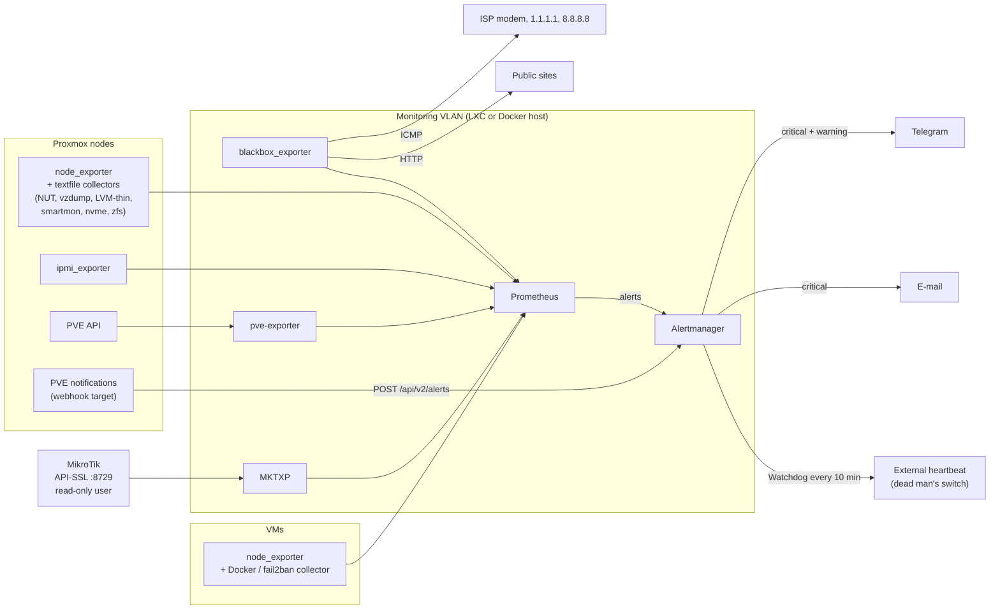

# n3xus-lab-observability

Prometheus and Alertmanager monitoring for a self-hosted Proxmox lab: UPS, server hardware, VMs and containers,
backups, a MikroTik router and the internet uplink. Alerts go to Telegram and e-mail, with a dead man's switch.

This is the sanitized version of the stack that has run 24/7 in my lab since October 2026. It covers two Proxmox
nodes, around 120 containers, a MikroTik RB5009, a NUT-managed UPS and about 50 public sites behind Cloudflare
Tunnel. Every rule has been tuned on real incidents, and the comments in the YAML say why each threshold is
what it is.

## What it watches

| Area | Source | Highlights |
|---|---|---|
| **UPS / power** | NUT → [`collectors/nut`](collectors/nut) | On battery, low battery, load, and temperature thresholds that tell an idle UPS from one still recharging after an outage |
| **Server hardware** | ipmi_exporter, node_exporter hwmon, smartmon / nvme / zfs collectors | BMC sensors (handles the inverted `chassis_*_fault_state` and empty-slot sensors), SEL events, SMART, NVMe wear/spare/media errors, ZFS |
| **Proxmox VE** | prometheus-pve-exporter (PVEAuditor token) | Guests with `onboot=1` that are stopped, storage usage, guests missing from every backup job |
| **Backups** | [`collectors/vzdump`](collectors/vzdump) | Failed, overdue, or "OK but with ERROR lines" vzdump runs. pve-exporter can't tell you these. |
| **LVM-thin** | [`collectors/lvm-thin`](collectors/lvm-thin) | Data and metadata usage of thin pools (a full pool means I/O errors in every guest) |
| **Docker hosts** | [`collectors/docker`](collectors/docker) | Unhealthy containers, restart loops, fail2ban jail status. One `docker inspect` per minute, no cAdvisor. |
| **Host** | node_exporter | Disk, memory, swap *thrashing* (not swap usage), OOM kills, failed systemd units, reboots |
| **MikroTik** | [MKTXP](mktxp) over API-SSL with a read-only user | WAN/server links, flapping, negotiated speed/duplex, errors/drops, CPU, temperature, certificates, WAN drop spikes |
| **Internet** | blackbox ICMP | Separates "ISP is down" from "modem/cable" and from "tunnel/origin" |
| **Sites** | blackbox HTTP | Per-target severity. A 401/403/404 from the origin counts as up (the tunnel answered); 5xx/530 counts as down. |
| **Proxmox notifications** | PVE webhook target | vzdump/updates/fencing/replication events go to the same Telegram chat, through Alertmanager or directly ([docs](proxmox/notifications)) |

## Architecture



Routing (in [`alertmanager/alertmanager.yml`](alertmanager/alertmanager.yml)):

- **critical** goes to Telegram and e-mail. **warning** goes to Telegram only.
- **energy="yes"** (UPS) goes to Telegram only, because NUT already sends its own e-mail.
- **Proxmox** events are sent once each, never repeated. `info` events are silent.
- **Watchdog** fires all the time and goes to an external heartbeat endpoint. If the heartbeats stop, that
  endpoint alerts you, so a dead monitoring stack can't stay silent.
- Inhibitions: a host that is down mutes everything else on that host. When the internet is down, site alerts
  are muted.

## Quickstart (Docker Compose)

Requires Docker with Compose v2.

```bash
git clone https://github.com/Samurai33/n3xus-lab-observability.git
cd n3xus-lab-observability

# 1. Secrets (ignored by git). See secrets/README.md for the full list.
printf '%s' '<bot token>' > secrets/telegram_bot_token
printf '%s' '<smtp password>' > secrets/smtp_password
printf '%s' '<heartbeat token>' > secrets/heartbeat_token
cp pve-exporter/pve.yml.example secrets/pve.yml          # then put a real PVEAuditor token in it
chmod 600 secrets/*

# 2. Point it at your lab: hosts in prometheus/prometheus.yml, chat id and e-mail in alertmanager/alertmanager.yml,
#    router address in mktxp/mktxp.conf (or delete the mktxp service and job if you have no MikroTik).

# 3. Validate, then start
./scripts/ci-local.sh
docker compose up -d
```

Prometheus is at <http://127.0.0.1:9090> and Alertmanager at <http://127.0.0.1:9093>.

### On the hosts

The node-side pieces are plain shell or Python scripts that run from systemd timers. Each one writes a `.prom`
file for the [node_exporter textfile collector](https://github.com/prometheus/node_exporter#textfile-collector)
(default dir on Debian: `/var/lib/prometheus/node-exporter`):

```bash
apt install prometheus-node-exporter prometheus-node-exporter-collectors   # smartmon, nvme, apt, zfs...
install -m 755 collectors/nut/nut-textfile.sh /usr/local/sbin/nut-textfile
install -m 644 collectors/nut/nut-textfile.{service,timer} /etc/systemd/system/
systemctl daemon-reload && systemctl enable --now nut-textfile.timer
# same pattern for collectors/vzdump, collectors/lvm-thin (PVE nodes) and collectors/docker (Docker VMs)
```

Make the exporters listen only on the interface that faces the monitoring VLAN
(e.g. `--web.listen-address=<host ip>:9100`). Then allow only the Prometheus host to reach them in the firewall.

## Running it in an unprivileged LXC instead

That is how it runs in my lab: Debian packages for Prometheus, Alertmanager and blackbox, plus MKTXP and
pve-exporter in Python venvs. The units are in [`systemd/`](systemd). Things that bite:

- **ICMP in an unprivileged LXC.** `AmbientCapabilities=CAP_NET_RAW` does nothing there. Set
  `net.ipv4.ping_group_range = <gid> <gid>` in `/etc/sysctl.d/` with the prometheus gid.
- **pve-exporter with Python 3.13** rejects the default PVE CA (it has no `keyUsage`, and X509_STRICT is now on).
  Install a proper certificate on the node rather than setting `verify_ssl: false`.
- **IPMI** needs `/dev/ipmi0`, which is root-only. Use a sudoers rule limited to the FreeIPMI binaries plus
  `collector_cmd` in the ipmi_exporter config, not a root exporter.

## Repository layout

```
prometheus/          prometheus.yml + rules/ (meta, ups, hardware, host, proxmox, docker, sites, internet, mikrotik)
alertmanager/        alertmanager.yml + templates/lab.tmpl (Telegram HTML + e-mail)
blackbox/            ICMP and "published site" HTTP modules
mktxp/               MKTXP config + RouterOS read-only setup and rollback
pve-exporter/        pve.yml example (PVEAuditor token)
collectors/          textfile collectors: nut, vzdump, lvm-thin, docker (+ systemd units)
proxmox/notifications/  PVE webhook bodies: via Alertmanager or straight to Telegram
systemd/             units for running the exporters outside Docker (hardened)
scripts/ci-local.sh  promtool + amtool + gitleaks + syntax checks, all in Docker
```

## Lessons baked into the rules

- **Swap used ≠ memory pressure.** After a backup, cold pages sit in swap and stay there, which is harmless. The
  rules alert on the rate of *swap-in* (`node_vmstat_pswpin`), not on how full swap is.
- **UPS temperature depends on context.** After any battery use, the charger keeps the internal sensor 15–25 °C
  warmer for hours. A single threshold either misses a real problem or alerts after every outage.
- **Modem rules arm only after a first reply.** Alerting on a modem that never answered ping from the monitoring
  VLAN is noise. Those rules use `max_over_time(...[24h] offset 5m) == 1`.
- **pve-exporter can't see whether backups worked.** It knows a guest is in a job, not whether the last run
  succeeded. The vzdump collector reads the per-guest log instead.
- **NUT 2.8.1 upsmon and calibration.** After any `test.battery.*` command, restart `nut-monitor`. A stale `CAL`
  flag plus a brief loss of communication (for example, a router reboot) makes upsmon assume the UPS is dead and
  start a forced shutdown.

## Checks

There is no hosted CI. Before each commit, `./scripts/ci-local.sh` runs these checks in Docker:
`promtool check config` (which also checks the rules), `amtool check-config`, gitleaks over the git history and
the working tree, and a syntax check of the collectors.

## License

[MIT](LICENSE)
